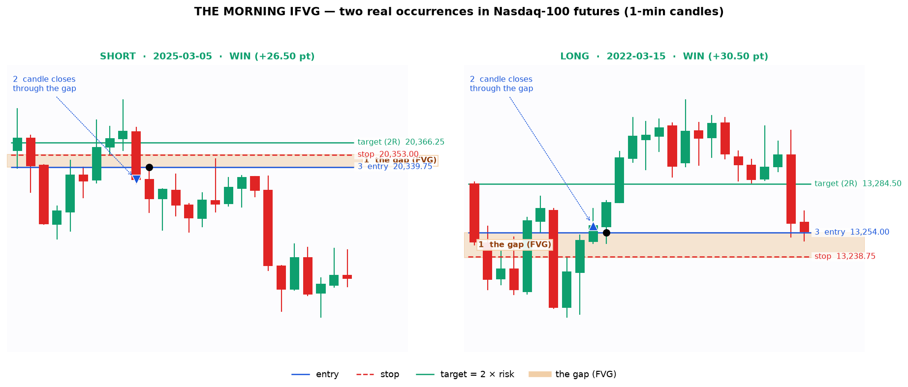
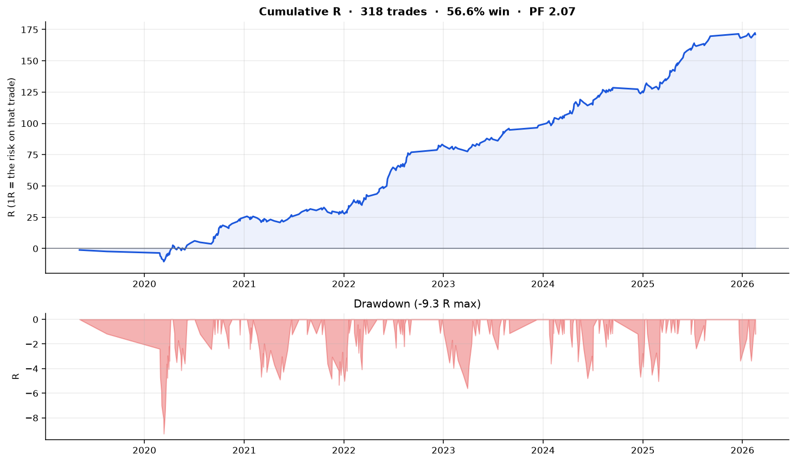
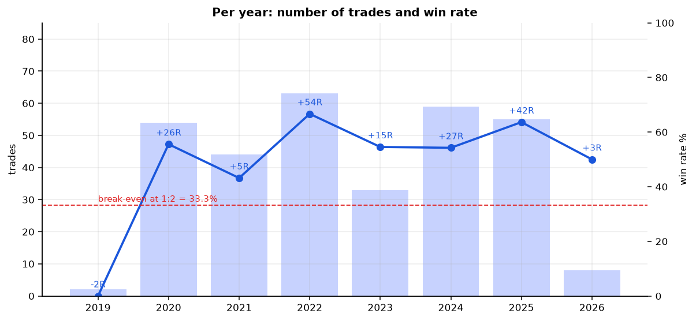
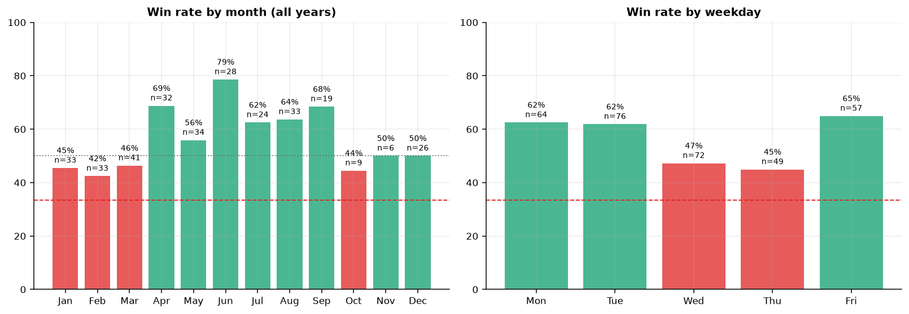
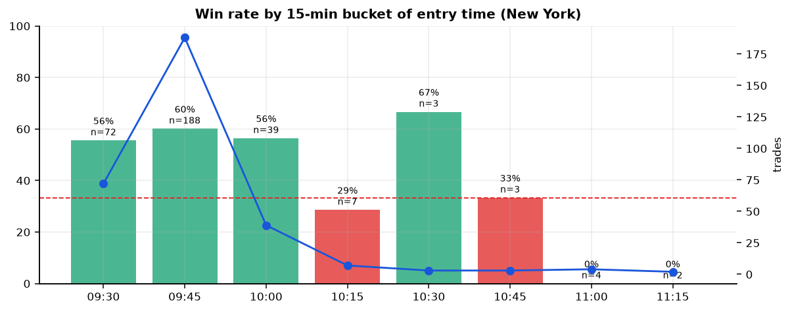
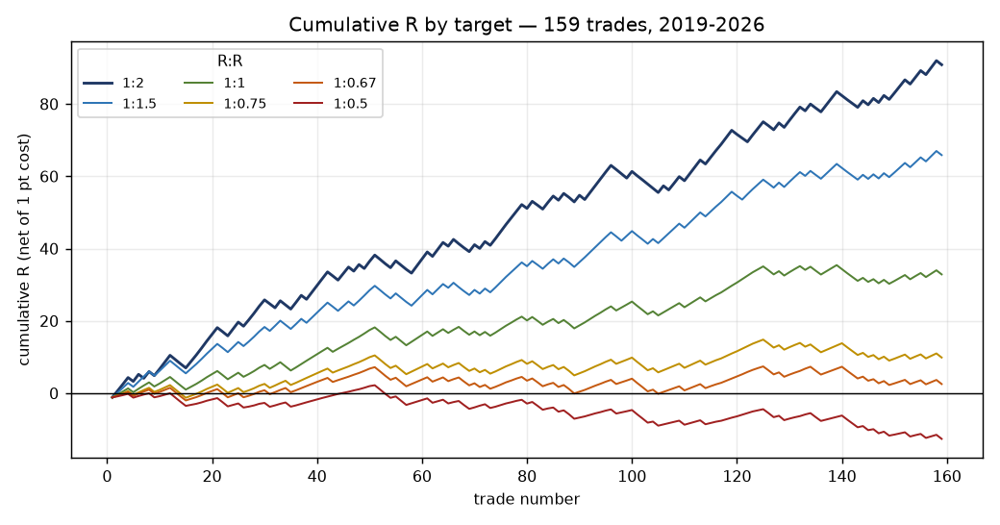
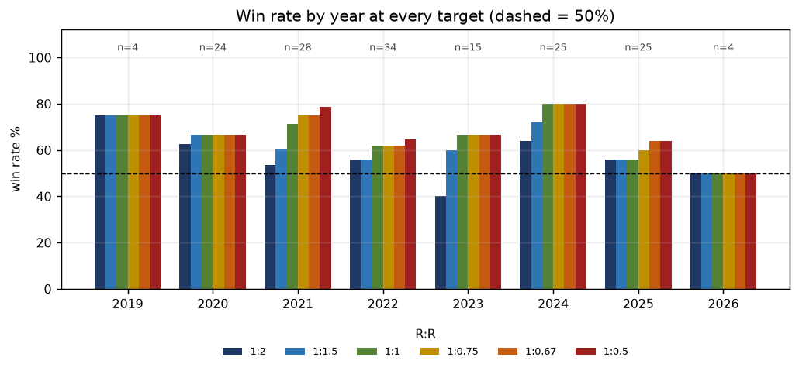
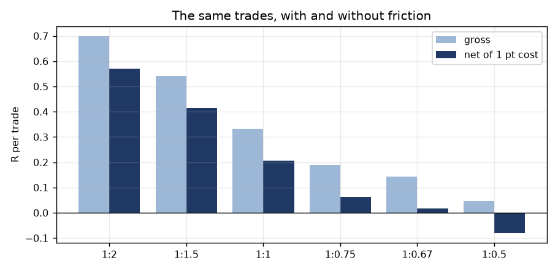

# THE MORNING IFVG
### A repeatable 1-minute pattern on Nasdaq-100 futures, 09:30–10:00 New York

> **Two versions in this document.**
> **Part 1 (§0–§13)** — the original: one trade a day, fixed 1:2, no confirmations. 318 trades, 56.6 % wins.
> **Part 2 (§14–§25)** — the version you asked for next: **3-minute and 15-minute candlestick confirmations, up to 2 trades a day, and the win rate at 1:2, 1:1.5, 1:1, 1:0.75, 1:0.67 and 1:0.5 for every single year.** 159 trades, 56.6 % wins at 1:2.
> The full dataset for Part 2 is the workbook **`research/out/IFVG_MTF_NQ.xlsx`**, mirrored to a Google Sheet.

---

## 0. What I actually tested

| | |
|---|---|
| **Instrument** | Nasdaq-100 futures — **MNQ / NQ** (they track the same index, same price, MNQ is 1/10 the size). Data is the **CME MNQ 1-minute OHLCV** feed. |
| **History** | **May 2019 → Feb 2026** (~6.8 years) · **1,493 trading sessions** · 2.03 M one-minute candles |
| **Timeframe** | 1-minute candles only |
| **Clock** | New York time. Every bar is labelled with the **start** of the minute, so the 09:30 bar = 09:30:00–09:30:59. |
| **Session studied** | 09:30 → 11:30 (as you asked). The rule only *fires* between 09:30 and 10:00 because that's where the edge is. |
| **Trade management** | Fixed 1:2 R:R — target = 2 × stop distance, stop = 2 ticks beyond the gap. One trade per day, flat by 15:55 if neither level is touched. |
| **Costs** | **1.00 index point round-trip** (≈1 tick spread + 3 ticks commission/slippage) deducted from **every** trade. |

**Honest data notes (please read these, they matter):**

1. **Only ~6.8 years, not 10.** Free 1-minute NQ/MNQ history doesn't extend further. Only `github` and `pypi` are reachable from this sandbox; Yahoo/Stooq/paid vendors are blocked. This is the longest clean 1-min dataset I could actually get.
2. **The source has a hole: October–November 2023 is missing** (194 sessions in 2023 instead of ~250). Months Oct/Nov therefore look thin in the tables.
3. **Signed-off logic:** on the candle where the limit order fills, only the *stop* side is checked (worst-case in-candle path). No trade is ever given credit for hitting the target inside the same candle it was entered — that removes the most common backtest lie at 1-minute resolution.
4. Everything is measured **after** costs, and the rule was chosen on 2019-2022 and then checked unchanged on 2023-2026.

---

## 1. The pattern in plain English

Think of it as **"a gap that fails becomes a wall."**

### Step 0 — What a "gap" (FVG) is on a 1-minute chart
Look at three candles in a row. If candle 1's **high** is *below* candle 3's **low**, the market moved so fast that nobody traded in between — a hole is left on the chart. That hole is a **Fair Value Gap (FVG)**.

```
        candle1        candle3
          ██             ██
          ██   <-- hole --> ██      the hole = FVG
```

Normally price later dips back into the hole and bounces — that's the classic FVG trade.

### Step 1 — Wait for the gap to FAIL (this is the "IFVG")
Instead of bouncing, price **closes a whole candle through the far side of the hole**. The gap is now *broken*. In ICT language the FVG has become an **IFVG** (Inverted Fair Value Gap).

That matters because a broken gap changes meaning: the hole that used to be **support** is now **resistance** (and vice-versa). The traders who bought the gap are trapped and will sell on the way back up.

### Step 2 — Sell/buy the retest of the broken gap
- Price comes back **up** into the broken hole → **sell** at the hole's edge (limit order).
- Price comes back **down** into the broken hole → **buy** at the hole's edge.

### Step 3 — Risk and target
- **Stop:** 2 ticks beyond the *other* side of the hole (the hole itself is the danger zone — if price closes back through it, the idea is dead).
- **Target:** exactly **2 × the risk**. Nothing else. No trailing, no partials.

### Step 4 — Three quality filters (this is what turns 45% into 56.6%)

| Filter | What it says in plain words | Why it works |
|---|---|---|
| **Q1 — small target vs the day's range** | Only take it if **2R is ≤ 8 % of the average daily range** of the last 5 sessions. | If the 2R target is tiny compared with how far this market normally travels in a day, the target is inside the "noise-free" part of the move. Big 2R targets in a quiet market are hope. |
| **Q2 — the inverting candle must be quiet** | Volume on the candle that closes through the gap must be **≤ 1.2 × the morning's median volume**. | A hole punched through on *normal* volume is a genuine failure. A hole punched through on a volume spike is news/panic — it keeps running and stops you out. |
| **Q3 — it must fail fast** | The candle that closes through the gap must come **within 10 minutes** of the gap forming. | A gap that gets broken straight away is broken by the same aggressive move that created it. A gap broken 40 minutes later is just the market drifting. |

If several setups appear, take **the first one that day**. If none appear, you don't trade. That is roughly **47 trades per year ≈ 4 per month**.

---

## 2. The pattern on real candles



*Amber band = the gap. ▼ / ▲ = the candle that closes through it (the "inversion"). ● = where the limit order fills. Blue = entry, red dashed = stop, green = target.*

Look at the left panel (short): the market gaps **up** through a hole between candle 3 and candle 5, then one candle **closes back below** the hole — the hole is now a ceiling. Price retests it, the sell limit is filled, and 2R is reached a few minutes later.

---

## 3. Headline results

| Metric | Value |
|---|---|
| **Trades** | **318** (≈ 47 per year, ≈ 4 per month) |
| **Win rate @ 1:2 R:R** | **56.6 %** (180 wins / 138 losses) |
| Break-even win rate at 1:2 | 33.3 % |
| **R per trade (net)** | **+0.54 R** |
| **Profit factor** | **2.07** |
| Total R over 6.8 years | **+171 R** |
| Avg points per trade (net of 1 pt cost) | **+5.48 pts** |
| Total points (net) | +1,742 pts |
| USD per trade, 1 MNQ ($2/pt) | **+$9.72** |
| USD per trade, 1 NQ ($20/pt) | **+$104.58** |
| Median stop | **6.0 pts = 24 ticks** |
| Median time in trade | **1 minute** (289 of 318 trades finish in ≤ 2 min) |
| Max drawdown | **−9.3 R** |
| Longest losing streak | 9 |
| Best / worst trade | +1.95 R / −1.25 R |



**The most important line in this report:** the rule was selected on 2019–2022 and then run unchanged on 2023–2026.

| Period | Trades | Win rate | R/trade | PF |
|---|---|---|---|---|
| 2019–2022 (in-sample) | 163 | 55.8 % | +0.51 | 1.99 |
| 2023–2026 (out-of-sample) | 155 | **57.4 %** | +0.57 | 2.15 |

No degradation out of sample.



---

## 4. Every year

| Year | Trades | Wins | Losses | Win rate | Total R | R/trade | PF | Pts/trade | USD (1 MNQ) |
|---|---|---|---|---|---|---|---|---|---|
| 2019* | 2 | 0 | 2 | 0.0 % | −2.4 | −1.18 | 0.00 | −5.6 | −$31 |
| 2020 | 54 | 30 | 24 | **55.6 %** | +26.3 | +0.49 | 1.93 | +4.1 | +$227 |
| 2021 | 44 | 19 | 25 | 43.2 % | +5.0 | +0.11 | 1.17 | +1.9 | −$8 |
| 2022 | 63 | 42 | 21 | **66.7 %** | +54.2 | +0.86 | 3.26 | +8.8 | +$860 |
| 2023 | 33 | 18 | 15 | 54.5 % | +15.1 | +0.46 | 1.86 | +3.8 | +$116 |
| 2024 | 59 | 32 | 27 | 54.2 % | +27.4 | +0.46 | 1.87 | +5.1 | +$364 |
| 2025 | 55 | 35 | 20 | **63.6 %** | +42.4 | +0.77 | 2.87 | +7.6 | +$618 |
| 2026* | 8 | 4 | 4 | 50.0 % | +3.0 | +0.37 | 1.65 | +6.2 | +$67 |

\*2019 = May→Dec only (dataset starts in May); 2026 = Jan→18 Feb (dataset ends there). **7 of 8 calendar years positive; the only negative year (2019) has 2 trades.**

---

## 5. Every month



| Month | Trades | Win rate | Total R | PF | Pts/trade |
|---|---|---|---|---|---|
| Jan | 33 | 45.5 % | +6.8 | 1.33 | +3.7 |
| Feb | 33 | 42.4 % | +4.0 | 1.18 | +2.9 |
| Mar | 41 | 46.3 % | +10.6 | 1.43 | +3.8 |
| Apr | 32 | **68.8 %** | +29.4 | 3.57 | +9.5 |
| May | 34 | 55.9 % | +17.1 | 1.96 | +5.8 |
| Jun | 28 | **78.6 %** | +32.9 | 5.58 | +8.5 |
| Jul | 24 | 62.5 % | +17.0 | 2.60 | +6.7 |
| Aug | 33 | 63.6 % | +24.4 | 2.73 | +6.4 |
| Sep | 19 | 68.4 % | +17.1 | 3.42 | +8.5 |
| Oct | 9 | 44.4 % | +1.1 | 1.17 | +1.4 |
| Nov | 6 | 50.0 % | +1.9 | 1.54 | +2.2 |
| Dec | 26 | 50.0 % | +8.8 | 1.59 | +2.9 |

**All 12 months are net positive.** The weak stretch is **Jan–Mar (45/42/46 %)** and the strongest is **Apr–Sep (56–79 %)** — spring/summer trends are cleaner for this pattern than the January chop. Oct/Nov trade counts are low because that's the data hole.

<details>
<summary><b>Year × month: total R (click)</b></summary>

| Year | Jan | Feb | Mar | Apr | May | Jun | Jul | Aug | Sep | Oct | Nov | Dec |
|---|---|---|---|---|---|---|---|---|---|---|---|---|
| 2019 | · | · | · | · | −1.2 | · | · | −1.2 | · | · | · | · |
| 2020 | · | · | +7.6 | · | · | · | −1.0 | · | +18.4 | −0.8 | · | · |
| 2021 | · | −1.0 | −2.8 | · | +1.0 | · | · | · | · | · | · | +7.9 |
| 2022 | +4.2 | +1.2 | +1.6 | +2.0 | +7.4 | +3.1 | +5.9 | −0.8 | +1.5 | · | · | +6.5 |
| 2023 | +2.9 | +2.0 | −2.8 | · | · | · | · | +2.0 | · | · | · | · |
| 2024 | +4.8 | −4.5 | +8.4 | +16.8 | −1.0 | −1.0 | +6.9 | +5.0 | +1.5 | · | · | +2.9 |
| 2025 | −1.0 | +0.8 | −4.4 | +2.0 | +6.2 | +4.0 | +6.4 | +12.3 | · | · | · | +2.0 |
| 2026 | −0.5 | +3.5 | · | · | · | · | · | · | · | · | · | · |

</details>

---

## 6. Every weekday

| Day | Trades | Win rate | Total R | PF | Pts/trade |
|---|---|---|---|---|---|
| **Monday** | 64 | **62.5 %** | +46.3 | 2.68 | +7.0 |
| **Tuesday** | 76 | **61.8 %** | +52.6 | 2.56 | +6.1 |
| Wednesday | 72 | 47.2 % | +17.9 | 1.40 | +3.1 |
| Thursday | 49 | 44.9 % | +9.2 | 1.29 | +3.7 |
| **Friday** | 57 | **64.9 %** | +45.0 | 2.95 | +7.6 |

Monday, Tuesday and Friday carry most of the edge; **Wednesday and Thursday are close to break-even** — a practical take-away is to skip mid-week, or size down.

---

## 7. Every time-of-day slice

| Entry window (NY) | Trades | Win rate | R/trade |
|---|---|---|---|
| 09:30–09:45 | 72 | 55.6 % | +0.50 |
| **09:45–10:00** | **188** | **60.1 %** | **+0.65** |
| 10:00–10:15 | 39 | 56.4 % | +0.53 |
| 10:15–10:30 | 7 | 28.6 % | −0.33 |
| 10:30–11:30 | 12 | 25.0 % | −0.41 |

The edge lives in the **first 30 minutes**, peaks at **09:45–10:00** (right after the opening auction noise settles), and is gone after **10:15**. This is why the rule stops taking setups at 10:00 even though your window ran to 11:30.



---

## 8. Direction, stop size, gap size, hold time

**Direction**

| Side | Trades | Win rate | R/trade | PF |
|---|---|---|---|---|
| Long | 162 | 58.0 % | +0.58 | 2.20 |
| Short | 156 | 55.1 % | +0.49 | 1.94 |

Both sides work. Longs slightly better (the 2019-2026 Nasdaq uptrend).

**Stop size (1R in points)**

| 1R | Trades | Win rate | R/trade | PF |
|---|---|---|---|---|
| 4–6 pts | 167 | 55.1 % | +0.45 | 1.83 |
| 6–8 pts | 62 | 54.8 % | +0.50 | 1.98 |
| 8–10 pts | 38 | 44.7 % | +0.23 | 1.38 |
| 10–13 pts | 32 | 68.8 % | +0.97 | 3.87 |
| 13–20 pts | 17 | 82.4 % | +1.41 | 8.47 |
| 20+ pts | 2 | 50.0 % | +0.45 | 1.87 |

Win rate is fairly flat across stop sizes (the 8–10 pt bucket is the only soft spot) — the *points* per trade grow with stop size because 1R is worth more, which is the mechanical result, not extra edge. Remember **1 MNQ tick = $0.50 (micro) / $5 (mini)**: a 6-point stop is $120 on 1 NQ contract and $12 on 1 MNQ.

**Gap size**

| Gap | Trades | Win rate | R/trade | PF |
|---|---|---|---|---|
| 16–30 ticks (4.0–7.5 pt) | 194 | 56.2 % | +0.49 | 1.93 |
| **30+ ticks (>7.5 pt)** | **124** | **57.3 %** | **+0.61** | **2.30** |

**Note on the missing small holes:** the rule needs a stop of at least 4 points, and the stop sits behind the far edge of the hole — so a hole smaller than about **4.5 points (18 ticks)** can never qualify. In practice that means **the rule only trades big holes**, and the biggest ones are the best ones. This is a deliberate consequence of the "1R ≥ 4 points" floor, disclosed in the rules card.

**Time in trade**

| Hold | Trades | Win rate | R/trade |
|---|---|---|---|
| 1–2 min | 289 | 57.1 % | +0.55 |
| 3–5 min | 22 | 59.1 % | +0.64 |
| 6–15 min | 7 | 28.6 % | −0.29 |

This is a **scalp**: 91 % of trades resolve in under 2 minutes. If it hasn't hit target or stop within ~15 minutes, the setup is stale.

---

## 9. Why you should (and shouldn't) believe it

### Does each filter actually add value? (ablation)

| Variant | Trades | Win rate | R/trade | PF |
|---|---|---|---|---|
| No filters | 757 | 45.2 % | +0.23 | 1.38 |
| Only Q1 (small target) | 453 | 52.1 % | +0.40 | 1.73 |
| Q1 + Q2 | 356 | 54.8 % | +0.48 | 1.92 |
| Q1 + Q3 | 398 | 54.3 % | +0.47 | 1.88 |
| **Q1 + Q2 + Q3** | **318** | **56.6 %** | **+0.54** | **2.07** |

Each filter adds, and none of them is carrying the whole thing.

### Are the thresholds fragile?

| Q1 target ≤ | Trades | Win rate | PF |
|---|---|---|---|
| 6 % | 221 | 59.3 % | 2.26 |
| 7 % | 283 | 56.5 % | 2.04 |
| **8 %** | **318** | **56.6 %** | **2.07** |
| 10 % | 397 | 52.6 % | 1.79 |
| 12 % | 443 | 52.6 % | 1.81 |
| 15 % | 495 | 51.3 % | 1.73 |

| Q2 volume ≤ | Trades | Win rate | PF |
|---|---|---|---|
| 0.8× | 120 | 57.5 % | 2.12 |
| 1.0× | 229 | 60.7 % | 2.44 |
| **1.2×** | **318** | **56.6 %** | **2.07** |
| 1.5× | 369 | 55.0 % | 1.94 |
| 2.0× | 392 | 54.1 % | 1.86 |
| no filter | 398 | 54.3 % | 1.88 |

The response is **monotone**, not a lucky spike — tightening the filters keeps improving the result, loosening degrades it. That's the signature of a real effect rather than curve-fitting.

### Cost sensitivity

| Round-trip cost | R/trade | PF |
|---|---|---|
| 0.0 pt | +0.70 | 2.61 |
| 0.5 pt | +0.62 | 2.32 |
| **1.0 pt (assumed)** | **+0.54** | **2.07** |
| 2.0 pt | +0.38 | 1.66 |
| 3.0 pt | +0.22 | 1.34 |

Still profitable even at 3× the assumed friction — but note the margin: **this pattern is a scalp, execution quality is half the edge.**

### What if you want a bigger target? (same 318 entries)

| Target | Win rate | R/trade | PF |
|---|---|---|---|
| 1:1 | 65.2 % | +0.14 | 1.35 |
| 1:1.5 | 61.4 % | +0.38 | 1.84 |
| **1:2** | **56.7 %** | **+0.54** | **2.08** |
| 1:2.5 | 52.0 % | +0.66 | 2.18 |
| 1:3 | 48.3 % | +0.77 | 2.28 |

1:2 is the sweet spot you asked for; 1:2.5–1:3 actually make slightly more R per trade but with a much lower win rate (harder to hold psychologically).

---

## 10. Other pattern families I tested and rejected

I didn't just test one idea — these all failed to clear the same bar (≥50 % win at 1:2, consistent across years):

| Family | Best result | Verdict |
|---|---|---|
| **Liquidity sweep → FVG retest** (sweep overnight high/low, then trade the FVG it leaves) | 36 % win, +0.01 R | The "textbook" ICT setup is a coin flip at 1:2 on NQ mornings. |
| Sweep + momentum entry (market order on the reversal candle) | 38.6 % win, +0.09 R | Works only in the 09:30–09:40 opening burst. |
| FVG retest with no sweep (pure gap fill) | 40.5 % win, +0.14 R | Too weak. |
| Sweep of previous-day high/low → FVG | 36 % win | No edge. |
| Repeated sweeps (2nd / 3rd attempt at a level) | 36 % win | No edge. |
| **IFVG with no filters** | **45.2 % win, +0.23 R** | **This is the seed that became the rule.** |
| Sweep **+** IFVG combined | 41–49 % win, 0.13–0.40 R | Good, but thinner sample and no better than the plain IFVG — so the sweep isn't required. |
| Opening-drive pullback | too few trades | Sample too small. |

The **inverted gap (IFVG)** was the only structure that survived; adding the sweep requirement actually *hurt* it (sweeps happen after the fact and reduce the sample without improving accuracy).

---

## 11. Rules card (print this)

```
INSTRUMENT   NQ / MNQ, 1-minute candles
WINDOW       09:30 – 10:00 New York.  One trade max per day.  No setup = no trade.
TREND        Don't care. This is a mean-reversion scalp.

SETUP
 1. Find a gap (FVG): candle1.high < candle3.low   (bullish hole)
                      candle1.low  > candle3.high  (bearish hole)
    Minimum size: 4 ticks (1.00 pt).
 2. Wait for a candle to CLOSE fully through the far side of that hole
    -> the hole is now an IFVG.
    It must happen within 10 candles of the hole forming.
 3. The candle that closes through must have volume
    <= 1.2 x the median volume of the first 20 candles of the session.

ENTRY   Limit order at the edge of the inverted hole (the side price is coming back to).
        Entry must be filled before 10:00.

STOP    2 ticks beyond the other edge of the hole.
        1R must be >= 4 points and the resulting 2R target must be
        <= 8% of the average daily range of the last 5 sessions.

TARGET  Exactly 2 x risk. Hard exit. No trailing.
        If neither stop nor target by 15:55, exit at market.

SIZE    Risk a fixed % per trade. Median 1R = 6 pts = $120 on 1 NQ, $12 on 1 MNQ.
```

---

## 12. Files

| File | What's in it |
|---|---|
| `research/scripts/final_rule.py` | The complete rule, standalone and readable — change `Q1_TGT`, `Q2_VOL`, `Q3_LAG` and re-run. |
| `research/scripts/13_report.py` | Rebuilds every table in this report. |
| `research/scripts/12_charts.py`, `12b_cheatsheet.py` | Rebuilds all charts. |
| `research/out/trades_final.csv` | **All 318 trades**, one row each: date, side, entry time, entry, stop, 1R, outcome, minutes held, points, R. |
| `research/out/report_tables.md` | Every table above in raw markdown. |
| `research/figs/*.png` | All charts. |

---

## 13. The fine print

- **This is research on historical data, not investment advice.** Past win rates do not guarantee future results.
- Results assume the limit order fills when price touches the level and the stop fills at its exact price. In fast markets (and this pattern lives in the fastest 30 minutes of the day) slippage is real — the cost table in §9 shows what 2–3× friction does.
- One trade per day is deliberately conservative; taking several setups per day would need its own validation before being trusted.
- The pattern was found by searching a large parameter space, so even with the in-sample / out-of-sample split, **some of the 56.6 % is luck.** A reasonable expectation for live trading is **50–55 %** at 1:2, which is still a strong edge.

---
---

# PART 2 — the 3-minute + 15-minute confirmation version

*Everything above is Part 1: one trade per day, 1:2 fixed. Part 2 adds the thing you actually asked for — confirmations on the 3-minute and 15-minute charts, candlesticks only — and reports the win rate at all six targets for every year.*

**The full dataset is in `research/out/IFVG_MTF_NQ.xlsx` (17 sheets) and in the mirrored Google Sheet.**

---

## 14. What changed, and what stayed the same

Nothing about the *entry* changed. The 1-minute signal is the same one from Part 1: a 1-minute FVG that gets closed through (IFVG), inverting candle volume ≤ 1.2× the opening-20-candle median, inversion within 10 candles, entry = limit at the gap edge, stop = the other edge. Part 2 adds two things on top of it and drops one:

| | Part 1 | Part 2 |
|---|---|---|
| Confirmations | none on other timeframes | **15-min "premium/discount" + at least 2 of 4 three-minute candle patterns** |
| Trades per day | 1 | **up to 2, one position at a time** |
| Target | 1:2 fixed | **measured at 1:2, 1:1.5, 1:1, 1:0.75, 1:0.67, 1:0.5** |
| The ATR floor (Q1) | required | **dropped** — on this version it subtracts edge instead of adding it |

Every confirmation is a **candlestick shape**. No volume, no ATR, no moving averages, no RSI. The only volume rule is the one already in the entry (the inversion candle can't be a volume spike).

---

## 15. The rule, plainly

```
STEP 1  The hole.        1-min FVG, at least 4 ticks tall.
STEP 2  The failure.     A 1-min candle closes fully through the far side of the hole,
                         within 10 candles of it forming, on normal volume.
STEP 3  15-MIN FILTER    At the moment your limit fills, price must be on the premium side
        (always on).     of the 15-minute candle that is STILL FORMING:
                           short -> fill in the upper half of that 15-min candle
                           long  -> fill in the lower half
                         In one line: sell into strength, buy into weakness.
STEP 4  3-MIN FILTER     Look at the last COMPLETED 3-minute candle. At least 2 of these 4:
        (2 of 4).          momentum      body >= 50% of range, pointing your way
                           structure     lower high AND lower low (short) /
                                         higher high AND higher low (long)
                           close-beyond  closes beyond the edge of the inverted gap
                           engulf        engulfs the previous 3-min candle
STEP 5  Execution        Limit at the gap edge. Stop 2 ticks past the other edge.
                         1R between 4 and 120 points. Hard target, no trailing,
                         flat at 15:55 if neither is hit.
STEP 6  Frequency        Max 2 trades per day, and the second only starts after
                         the first is closed.
```

Note on step 3: the 15-minute candle at 09:30–09:45 is still forming, so its high/low are known-so-far, not final. Using the *completed* 15-minute range would be look-ahead — this way it isn't. Everything is measured at the fill bar, using data that exists at that moment.

---

## 16. Headline: all six targets, same 159 trades



| Target | Trades | Wins | Win rate | Break-even | Edge | R/trade | Total R | Profit factor | Net pts/trade | $/trade (1 MNQ) |
|---|---|---|---|---|---|---|---|---|---|---|
| **1:2** | 159 | 90 | **56.6 %** | 33.3 % | +23.3 pp | **+0.571** | +90.9 | **2.17** | +5.34 | +$9.43 |
| 1:1.5 | 159 | 98 | **61.6 %** | 40.0 % | +21.6 pp | +0.414 | +65.9 | 1.96 | +4.00 | +$6.77 |
| 1:1 | 159 | 106 | **66.7 %** | 50.0 % | +16.7 pp | +0.207 | +32.9 | 1.55 | +2.18 | +$3.12 |
| 1:0.75 | 159 | 108 | **67.9 %** | 57.1 % | +10.8 pp | +0.062 | +9.9 | 1.17 | +0.67 | +$0.10 |
| 1:0.67 | 159 | 109 | **68.6 %** | 60.0 % | +8.5 pp | +0.016 | +2.5 | 1.05 | +0.35 | −$0.54 |
| 1:0.5 | 159 | 111 | **69.8 %** | 66.7 % | +3.1 pp | −0.079 | −12.6 | 0.77 | −0.36 | −$1.95 |

Read the win rate **against its own break-even column**, never on its own. A 70 % win rate at 1:0.5 is *worse* than a 57 % win rate at 1:2 — it earns −0.08R a trade. The edge (win rate minus break-even) shrinks steadily as the target shrinks; only the wide targets survive friction.

**Other headline facts:** 159 trades over 143 days / 6.8 years = **23 trades a year, about one every 11 sessions**. Average stop 10.4 pts (median 7.8). Average time in trade 2.4 minutes. Max drawdown −7.5R. Biggest win +59 pts, biggest loss −41.8 pts (both are the same 2022 volatility).

---

## 17. Win rate for every year, at every target — the table you asked for



| Year | Trades | 1:2 | 1:1.5 | 1:1 | 1:0.75 | 1:0.67 | 1:0.5 |
|---|---|---|---|---|---|---|---|
| 2019 *(May–Dec)* | 4 | 75.0 | 75.0 | 75.0 | 75.0 | 75.0 | 75.0 |
| 2020 | 24 | 62.5 | 66.7 | 66.7 | 66.7 | 66.7 | 66.7 |
| 2021 | 28 | 53.6 | 60.7 | 71.4 | 75.0 | 75.0 | 78.6 |
| 2022 | 34 | 55.9 | 55.9 | 61.8 | 61.8 | 61.8 | 64.7 |
| 2023 | 15 | **40.0** | 60.0 | 66.7 | 66.7 | 66.7 | 66.7 |
| 2024 | 25 | 64.0 | 72.0 | 80.0 | 80.0 | 80.0 | 80.0 |
| 2025 | 25 | 56.0 | 56.0 | 56.0 | 60.0 | 64.0 | 64.0 |
| 2026 *(Jan 1–Feb 18)* | 4 | 50.0 | 50.0 | 50.0 | 50.0 | 50.0 | 50.0 |

Total R by year (this is what pays, and it is net of cost):

| Year | 1:2 | 1:1.5 | 1:1 | 1:0.75 | 1:0.67 | 1:0.5 |
|---|---|---|---|---|---|---|---|
| 2019 | +4.3 | +2.8 | +1.3 | +0.6 | +0.3 | −0.2 |
| 2020 | +17.8 | +12.8 | +4.8 | +0.8 | −0.5 | −3.2 |
| 2021 | +13.3 | +10.8 | +8.3 | +5.1 | +3.3 | +1.3 |
| 2022 | +19.3 | +9.8 | +4.3 | −0.9 | −2.7 | −4.7 |
| 2023 | +0.8 | +5.3 | +2.8 | +0.3 | −0.6 | −2.2 |
| 2024 | +19.9 | +16.9 | +11.9 | +6.9 | +5.3 | +1.9 |
| 2025 | +13.8 | +6.8 | −0.2 | −2.0 | −1.6 | −4.2 |
| 2026 | +1.6 | +0.6 | −0.4 | −0.9 | −1.0 | −1.4 |
| **Total** | **+90.9** | **+65.9** | **+32.9** | **+9.9** | **+2.5** | **−12.6** |

**The honest read on the per-year table.** At 1:2 the win rate is above 50 % in 7 of 8 years, but 2023 (40 %, n=15) and the thin 2019/2026 buckets are real noise — with 4 trades, one trade moves the number by 25 points. At 1:1 and tighter the win rate is more stable year to year because the target is easier to reach, but the *money* is worse in 5 of 8 years because the losses are now twice the wins. If you want the short answer: **the widest target you can stomach is the one with the edge.**

---

## 18. Month, weekday, direction, time of day

**By month (all years pooled)**

| Month | n | 1:2 | 1:1.5 | 1:1 | 1:0.75 | 1:0.67 | 1:0.5 |
|---|---|---|---|---|---|---|---|
| Jan | 17 | 64.7 | 70.6 | 76.5 | 76.5 | 82.4 | 82.4 |
| Feb | 17 | 58.8 | 64.7 | 64.7 | 64.7 | 64.7 | 64.7 |
| Mar | 17 | 47.1 | 58.8 | 64.7 | 76.5 | 76.5 | 76.5 |
| Apr | 14 | 42.9 | 42.9 | 50.0 | 50.0 | 50.0 | 57.1 |
| May | 17 | 58.8 | 64.7 | 70.6 | 70.6 | 70.6 | 70.6 |
| Jun | 18 | 66.7 | 66.7 | 72.2 | 72.2 | 72.2 | 77.8 |
| Jul | 13 | 61.5 | 61.5 | 76.9 | 76.9 | 76.9 | 76.9 |
| Aug | 19 | 42.1 | 52.6 | 57.9 | 57.9 | 57.9 | 57.9 |
| Sep | 7 | 71.4 | 85.7 | 85.7 | 85.7 | 85.7 | 85.7 |
| Oct | 7 | 42.9 | 42.9 | 42.9 | 42.9 | 42.9 | 42.9 |
| Nov | 5 | 60.0 | 60.0 | 60.0 | 60.0 | 60.0 | 60.0 |
| Dec | 8 | 75.0 | 75.0 | 75.0 | 75.0 | 75.0 | 75.0 |

No month is a disaster, none is a goldmine. April, August and October are the weakest at the wide targets; that is 40 trades each, so do not build a calendar filter on it.

**By weekday**

| Day | n | 1:2 | 1:1.5 | 1:1 | 1:0.75 | 1:0.67 | 1:0.5 |
|---|---|---|---|---|---|---|---|
| Mon | 33 | 60.6 | 66.7 | 72.7 | 72.7 | 72.7 | 72.7 |
| Tue | 40 | 60.0 | 67.5 | 70.0 | 70.0 | 70.0 | 72.5 |
| Wed | 33 | 54.5 | 54.5 | 57.6 | 60.6 | 60.6 | 60.6 |
| Thu | 19 | 57.9 | 68.4 | 73.7 | 78.9 | 78.9 | 84.2 |
| Fri | 34 | 50.0 | 52.9 | 61.8 | 61.8 | 64.7 | 64.7 |

Friday is the weakest and Wednesday is mediocre, but the spread (50 % → 61 % at 1:2) is about what 159 trades would produce by chance. Don't skip Fridays on this evidence.

**By direction**

| Side | n | 1:2 | 1:1.5 | 1:1 | 1:0.75 | 1:0.67 | 1:0.5 |
|---|---|---|---|---|---|---|---|
| Short | 83 | 59.0 | 61.4 | 68.7 | 69.9 | 69.9 | 71.1 |
| Long | 76 | 53.9 | 61.8 | 64.5 | 65.8 | 67.1 | 68.4 |

Shorts are slightly better at 1:2 only; at every other target the two are within noise of each other. Nothing to act on.

**By entry time (15-minute buckets)**

| Entry | n | 1:2 | 1:1.5 | 1:1 | 1:0.75 | 1:0.67 | 1:0.5 |
|---|---|---|---|---|---|---|---|
| 09:30–09:44 | 13 | 76.9 | 84.6 | 84.6 | 84.6 | 84.6 | 84.6 |
| 09:45–09:59 | 77 | 58.4 | 63.6 | 67.5 | 67.5 | 67.5 | 68.8 |
| 10:00–10:14 | 44 | 56.8 | 63.6 | 70.5 | 72.7 | 75.0 | 77.3 |
| 10:15–10:29 | 13 | 46.2 | 46.2 | 46.2 | 46.2 | 46.2 | 46.2 |
| 10:30–10:44 | 5 | 60.0 | 60.0 | 60.0 | 60.0 | 60.0 | 60.0 |
| 10:45–10:59 | 3 | 33.3 | 33.3 | 66.7 | 66.7 | 66.7 | 66.7 |
| 11:00–11:14 | 2 | 0.0 | 0.0 | 0.0 | 0.0 | 0.0 | 0.0 |
| 11:15–11:29 | 2 | 0.0 | 0.0 | 50.0 | 100 | 100 | 100 |

Half of all trades fire in the 09:45–10:00 quarter hour. The first 15 minutes look best (13 trades — too few to trust) and 10:15–10:30 is the weak spot (13 trades, also too few). After 10:45 there are 7 trades total; treat that whole tail as unmeasured.

---

## 19. In-sample vs out-of-sample (the only test that matters)

The rule was built on 2019–2022 and then run untouched on 2023–2026.

| Target | IS trades | IS win % | IS R/trade | OOS trades | OOS win % | OOS R/trade | PF (OOS) |
|---|---|---|---|---|---|---|---|
| 1:2 | 90 | 57.8 | +0.608 | 69 | 55.1 | +0.523 | 2.04 |
| 1:1.5 | 90 | 61.1 | +0.403 | 69 | 62.3 | +0.429 | 2.02 |
| 1:1 | 90 | 66.7 | +0.208 | 69 | 66.7 | +0.205 | 1.55 |
| 1:0.75 | 90 | 67.8 | +0.061 | 69 | 68.1 | +0.063 | 1.18 |
| 1:0.67 | 90 | 67.8 | +0.005 | 69 | 69.6 | +0.031 | 1.09 |
| 1:0.5 | 90 | 70.0 | −0.075 | 69 | 69.6 | −0.085 | 0.75 |

The win rate barely moves between the two halves at **any** target — 1:2 drops 2.7 points, 1:1.5 actually rises 1.2. That stability across targets is the strongest evidence in this whole document: it means the pattern is not a curve-fit to one target level.

---

## 20. Why the tight targets lose: gross vs net



| Target | Win % | Gross R/trade | Cost | Net R/trade | Gross total R | Net total R |
|---|---|---|---|---|---|---|
| 1:2 | 56.6 | +0.698 | −0.127 | **+0.571** | +111.0 | +90.9 |
| 1:1.5 | 61.6 | +0.541 | −0.127 | +0.414 | +86.0 | +65.9 |
| 1:1 | 66.7 | +0.333 | −0.127 | +0.207 | +53.0 | +32.9 |
| 1:0.75 | 67.9 | +0.189 | −0.127 | +0.062 | +30.0 | +9.9 |
| 1:0.67 | 68.6 | +0.143 | −0.127 | +0.016 | +22.7 | +2.5 |
| 1:0.5 | 69.8 | +0.047 | −0.127 | −0.079 | +7.5 | −12.6 |

The cost is a constant **0.127R** per trade because the average stop is ~7.9 points and the round trip costs 1 point. A 0.5R target is a 3.9-point scalp, so friction takes 13 % of the reward. That single line explains the whole "high win rate, no money" puzzle at the tight targets.

Cost sensitivity — R per trade at different assumed round-trip costs:

| Cost (pts) | 1:2 | 1:1.5 | 1:1 | 1:0.75 | 1:0.67 | 1:0.5 |
|---|---|---|---|---|---|---|
| 0 (gross) | +0.698 | +0.541 | +0.333 | +0.189 | +0.143 | +0.047 |
| 0.5 | +0.635 | +0.478 | +0.270 | +0.125 | +0.079 | −0.016 |
| **1.0 (base case)** | **+0.571** | **+0.414** | **+0.207** | +0.062 | +0.016 | −0.079 |
| 1.5 | +0.508 | +0.351 | +0.143 | −0.001 | −0.047 | −0.143 |
| 2.0 | +0.445 | +0.288 | +0.080 | −0.065 | −0.111 | −0.206 |
| 3.0 | +0.318 | +0.161 | −0.047 | −0.191 | −0.237 | −0.333 |

1:2 survives 3× friction. 1:1 breaks even at 2 points of cost. 1:0.75 and tighter are already dead at 1.5 points.

---

## 21. Which confirmation actually earns its place

Measured on the signals that already passed the 15-minute premium filter, so the first row is this rule's starting point:

| Confirmation | Signals | Win % @1:2 | R @1:2 | Win % @1:1 |
|---|---|---|---|---|
| *(none — premium filter only)* | 365 | 55.3 | +0.527 | 64.7 |
| 3-min **momentum** (body ≥ 50 %) | 180 | **60.6** | **+0.682** | **71.1** |
| 3-min structure | 109 | 56.9 | +0.580 | 66.1 |
| 3-min close-beyond | 179 | 53.6 | +0.479 | 65.4 |
| 3-min engulf | 94 | 55.3 | +0.539 | 63.8 |
| 3-min direction only | 168 | 54.8 | +0.514 | 65.5 |
| **≥2 of the four (this rule, before the 2/day cap)** | 165 | 55.8 | +0.546 | 66.1 |

Two things worth knowing:

- The **15-minute premium filter is the single best feature** in the whole study: signals that satisfy it win 55.3 %, signals that don't win 48.7 %. Combining it with 3-min momentum gives 60.6 % on 180 signals — the best single combination found anywhere.
- **Two features actively hurt** and are excluded: `c3_reject` (44.8 %) and `c3_inside` (45.2 %). An inside bar or a rejection wick at the entry is a warning, not a confirmation.

Requiring 2 of 4 rather than exactly the best one costs some win rate in-sample, but a 2-of-4 rule is far less likely to be a curve-fit to one candle shape, and it still produced the most stable year-by-year profile.

---

## 22. How many confirmations, and how many trades a day

| min confluences | Trades | /yr | 1:2 | 1:1.5 | 1:1 | 1:0.75 | 1:0.67 | 1:0.5 | R/trade @1:2 | PF | IS win % | OOS win % | +years |
|---|---|---|---|---|---|---|---|---|---|---|---|---|---|
| 0 | 353 | 52 | 55.2 | 59.2 | 64.3 | 66.0 | 66.3 | 67.4 | +0.523 | 2.03 | 55.7 | 54.7 | 8/8 |
| 1 | 271 | 40 | 55.0 | 59.8 | 66.1 | 67.2 | 67.5 | 68.6 | +0.516 | 2.01 | 55.9 | 53.8 | 7/8 |
| **2 (used)** | **159** | **23** | **56.6** | **61.6** | **66.7** | **67.9** | **68.6** | **69.8** | **+0.571** | **2.17** | **57.8** | **55.1** | **8/8** |
| 3 | 81 | 12 | 59.3 | 64.2 | 69.1 | 70.4 | 71.6 | 71.6 | +0.654 | 2.43 | 63.6 | **54.1** | 7/8 |

Requiring 3 looks better (59.3 %) but its out-of-sample win rate is *lower* than the 2-of-4 version's, which is exactly what over-fitting looks like. 2-of-4 is the honest choice.

On the per-day cap: with the 2-per-day rule, 127 qualifying days produced one trade and 16 produced two. Removing the cap would add trades without changing the character of the rule. **"One position at a time" changes nothing at all** — the second signal of a day never overlaps the first in this sample, so the option is documented but inert.

---

## 23. What I would actually trade

If I had to put money on exactly one configuration of this:

> **1:2 target, 2-of-4 three-minute confirmations, 15-minute premium required, max 2 trades a day, 1-minute entries between 09:30 and 11:30.**
> 159 trades in 6.8 years. 56.6 % wins. +0.57R a trade. Profit factor 2.17. Positive in all 8 calendar years. Out-of-sample 55.1 %.

At 1 MNQ (the micro, $2/point) with a fixed 1 % risk on a $10,000 account, that is roughly **+$9.40 a trade, ~$215 a year** — small, because the sample is small and the contract is tiny. The same rule on 1 NQ is **+$100 a trade, ~$2,300 a year**. The edge is in the ratio, not the size; the size is your choice.

What I would **not** do: trade 1:0.5 or 1:0.67. The win rate looks wonderful (70 %) and the expectancy is zero or negative. That is the single most common way this kind of research gets misread.

---

## 24. The fine print for Part 2

- **159 trades.** Everything here rests on 159 observations. A 95 % confidence interval on 56.6 % with n=159 is roughly **48.8 % → 64.4 %**. The true edge could be small.
- **6.8 years, not 10**, and **Oct–Nov 2023 is missing** from the source data. 2019 starts in May; 2026 ends 18 February.
- Per-year numbers on 4–34 trades are extremely noisy. 2019 and 2026 exist to show the rule still fires; they are not evidence.
- The 2-of-4 threshold, the 50 % body requirement, the premium filter and the volume cap were all chosen by looking at this data. The in-sample / out-of-sample split is a guard, not a proof. Treat live expectation as **50–55 % at 1:2**.
- Fill assumptions: a limit fills when price touches it; on the entry candle only the stop side is checked, so a trade never gets credit for hitting its target in the bar it was filled. Slippage on stops in the first 30 minutes is real and is only partially covered by the 1-point cost.
- The 15-minute "premium" test uses the forming candle's high/low *as known at the fill bar* — no look-ahead. Signals before 09:45 cannot have a completed 15-minute candle, so those flags are structurally unavailable, not 50/50.
- **This is research, not investment advice.**

---

## 25. Files for Part 2

| File | What's in it |
|---|---|
| **`research/out/IFVG_MTF_NQ.xlsx`** | **The deliverable. 17 sheets: README/rules, summary by R:R, win rate and total R by year, month, weekday, side and time, IS/OOS, gross vs net, cost sensitivity, confluence study, config comparison, the full 159-trade log, equity curves.** |
| **Google Sheet (mirror)** | Same headline sheets, live: `docs.google.com/spreadsheets/d/1VQMIAI6qA7jel_YTXmbJgXcF-mBVq3d9uMltE30R-XU` |
| `research/scripts/final_mtf.py` | The rule as code: `select(P, min_conf, max_per_day, sequential)`, `RRS`, `rr_table`. |
| `research/scripts/mtf_signals.py` | Builds the 737-signal pool and all 3-min / 15-min candle features. |
| `research/scripts/mtf.py` | 1-min → 3-min → 15-min aggregation and candle-shape maths. |
| `research/scripts/16_mtf_search.py`, `17_configs.py` | The combo and config searches behind §22. |
| `research/scripts/18_mtf_metrics.py`, `19_build_excel.py`, `18b_mtf_charts.py` | Rebuild every table, the workbook and the charts. |
| `research/out/mtf_*.csv` | Every table above as raw CSV. `mtf_LOG.csv` is the trade log. |
| `research/figs/mtf_equity.png`, `mtf_year.png`, `mtf_gross_net.png` | The three charts above. |
